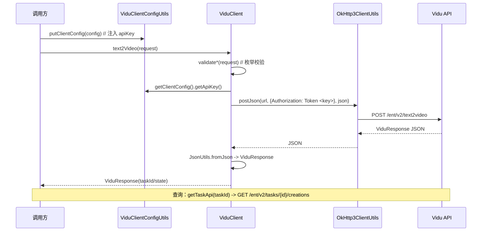

# 架构说明 / Architecture

> vidu-java-sdk 是 Vidu AI 视频生成开放 API（v2）的 Java 客户端封装。本文说明其模块结构、调用流程、配置注入与鉴权机制。

## 一、模块结构 / Modules

```
cn.net.yunlou.vidu
├── ViduClient.java              # 核心客户端：6 个生成/查询方法，@Component
├── ViduClientConfig.java        # 配置载体：domain / apiVersion / apiKey
├── ViduClientConfigUtils.java   # 配置管理：ConcurrentHashMap + ThreadLocal 注入
├── ViduException.java           # 业务异常（参数校验失败等）
├── package-info.java
└── sdk
    ├── ViduRequest.java         # 请求基类（泛型）
    ├── ViduResponse.java        # 响应：taskId/state/creations 等
    ├── Creation.java            # 单条生成结果
    ├── Text2VideoViduRequest.java
    ├── Img2VideoViduRequest.java
    ├── Reference2VideoViduRequest.java
    ├── StartEnd2VideoViduRequest.java
    ├── Template2VideoViduRequest.java
    ├── constant/ViduConstant.java   # API_DOMAIN + 各端点
    ├── enums/                      # ModelEnums / DurationEnums / ResolutionEnums /
    │                                #   AspectRatioEnums / StyleEnums / TemplateEnums /
    │                                #   MovementAmplitudeEnums
    └── video/                      # Model / VideoConfig / VideoConfigFactory
```

## 二、调用流程 / Call Flow



## 三、配置注入机制 / Configuration

`ViduClientConfigUtils` 以**内存**方式管理配置，不读取任何外部文件或环境变量：

- `putClientConfig(config)` / `setThreadLocalClientConfig(config)`：将 `ViduClientConfig` 存入全局 `ConcurrentHashMap`（以 `apiKey` 为键），并可选绑定到当前线程 `ThreadLocal`。
- `getClientConfig()`：优先从 `ThreadLocal` 取 `apiKey`，否则取默认配置 `_default_config_key_`。

> 这意味着 API Key **必须由调用方显式注入**（如从环境变量读取后 `setApiKey`）。虽然灵活，但也容易诱使开发者把密钥硬编码进代码——请勿如此，详见 SECURITY.md。

## 四、鉴权 / Authentication

所有请求在 Header 中携带：

```
Authorization: Token <apiKey>
```

- 前缀为字面量 `Token`（非 `Bearer`），后接空格与 API Key；
- 由 `ViduClient` 各方法统一注入，无需调用方逐请求设置。

## 五、端点 / Endpoints（`ViduConstant`）

| 能力 | 端点 |
| --- | --- |
| 文生视频 | `POST /ent/v2/text2video` |
| 图生视频 | `POST /ent/v2/img2video` |
| 参考生视频 | `POST /ent/v2/reference2video` |
| 首末帧生视频 | `POST /ent/v2/start-end2video` |
| 模板生视频 | `POST /ent/v2/template2video` |
| 任务查询 | `GET /ent/v2/tasks/{id}/creations` |

基础域：`https://api.vidu.cn`（生产）。测试配置中出现的 `https://api.vidu.zone` 为测试域。

## 六、依赖与可构建性 / Dependencies

- 运行时依赖：`cn.net.yunlou:common-utils:1.0.0`（**内部依赖，未上 Maven Central**）、`jakarta.validation-api:2.0.2`、`junit:4.13.1`（test）。
- 经 `common-utils` 间接引入：OkHttp3、Jackson、Guava、Hibernate Validator 等。
- **可构建性风险**：外部用户缺少 `common-utils` 时无法编译/打包。详见 SECURITY.md 风险 #2。
